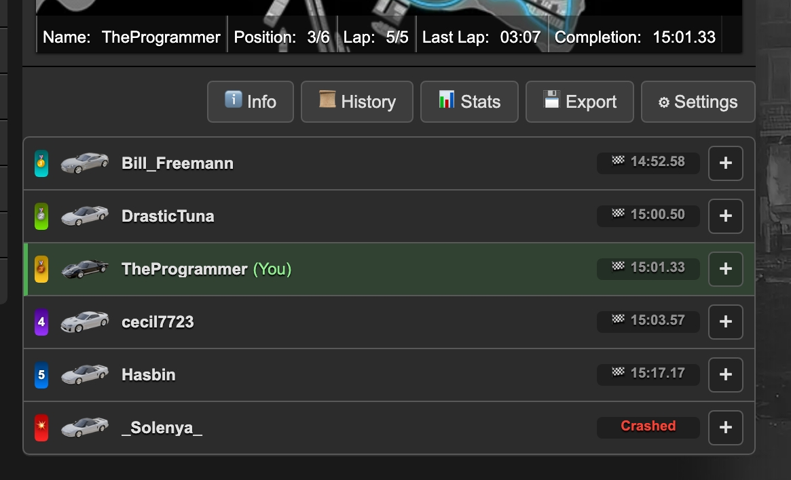
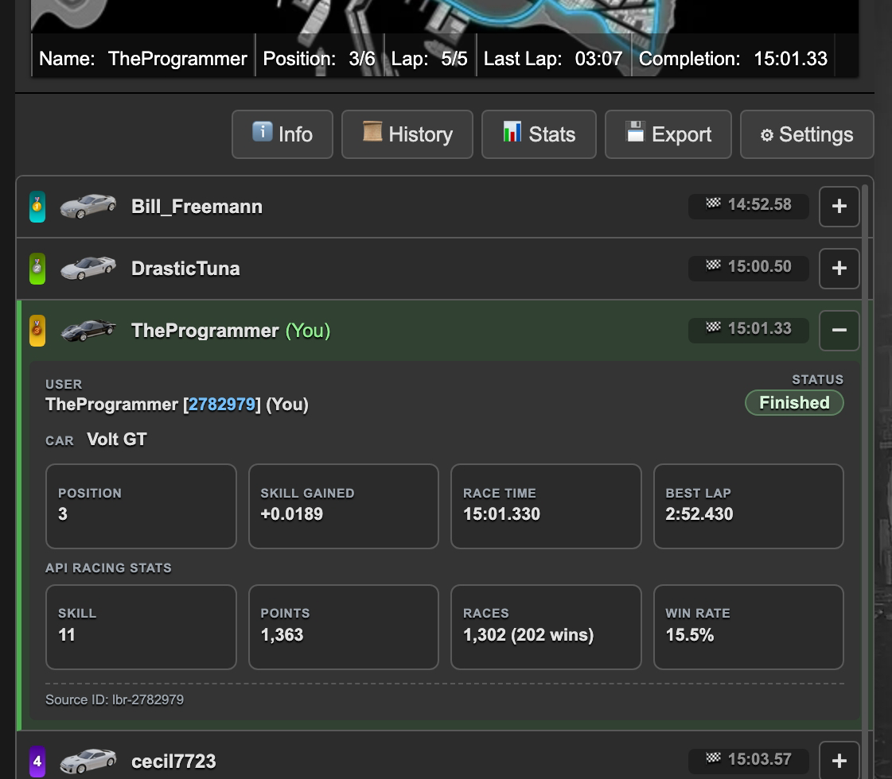
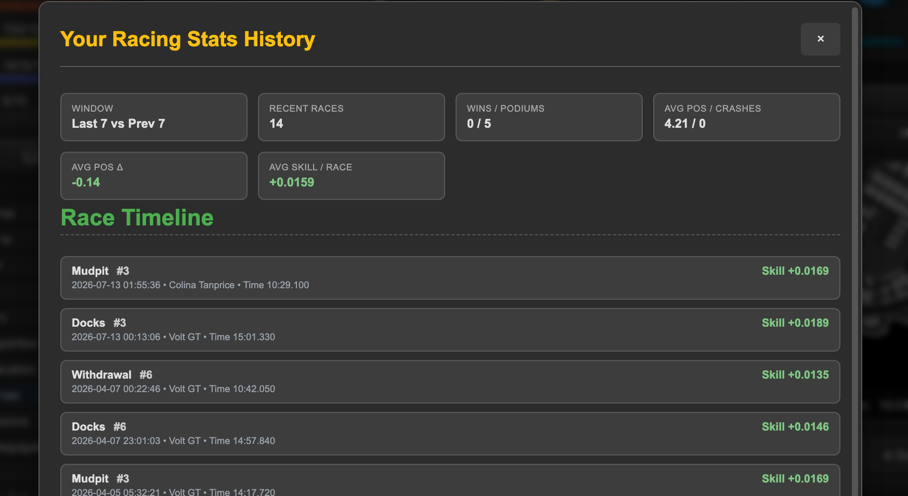
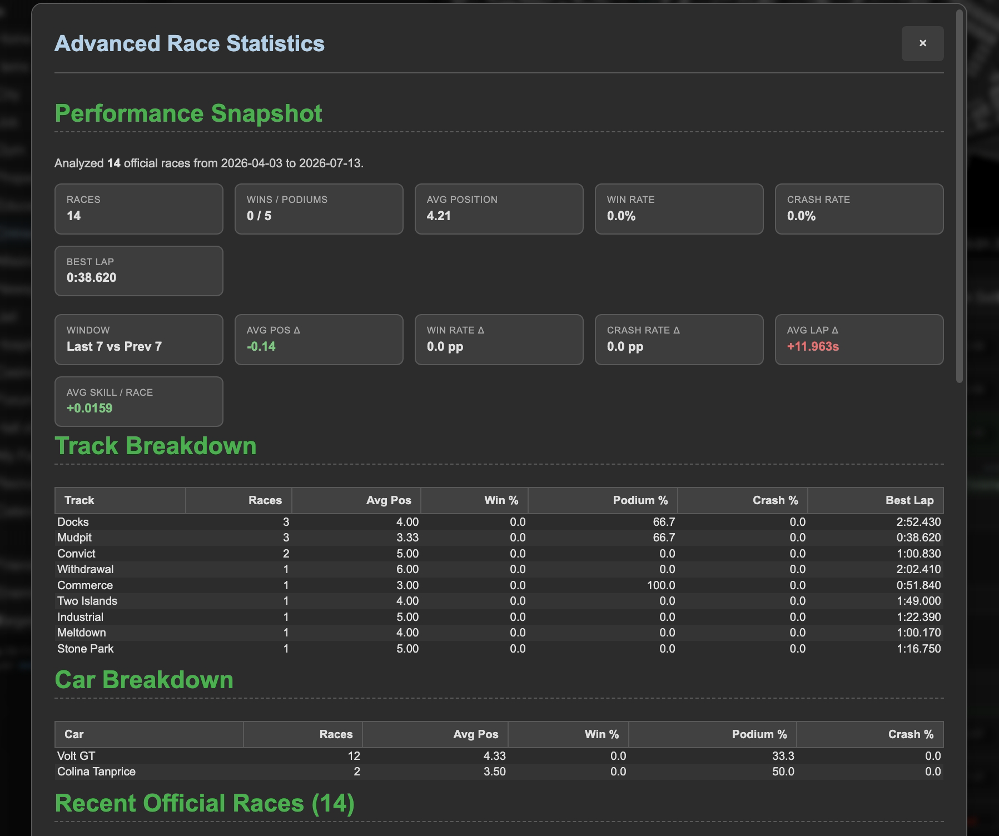
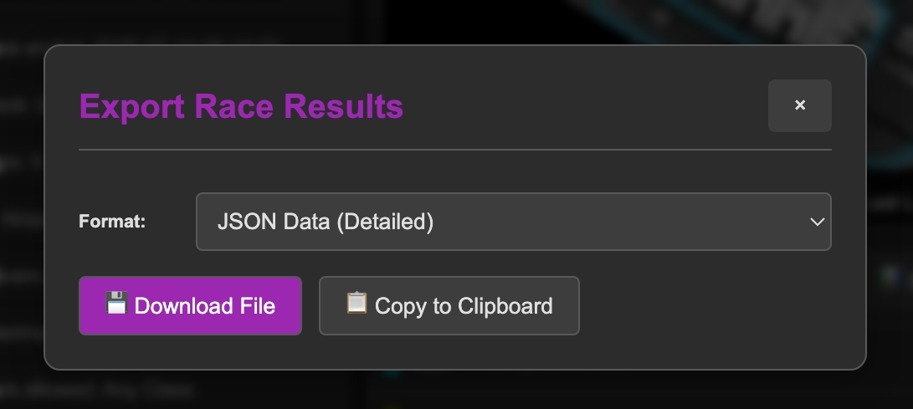
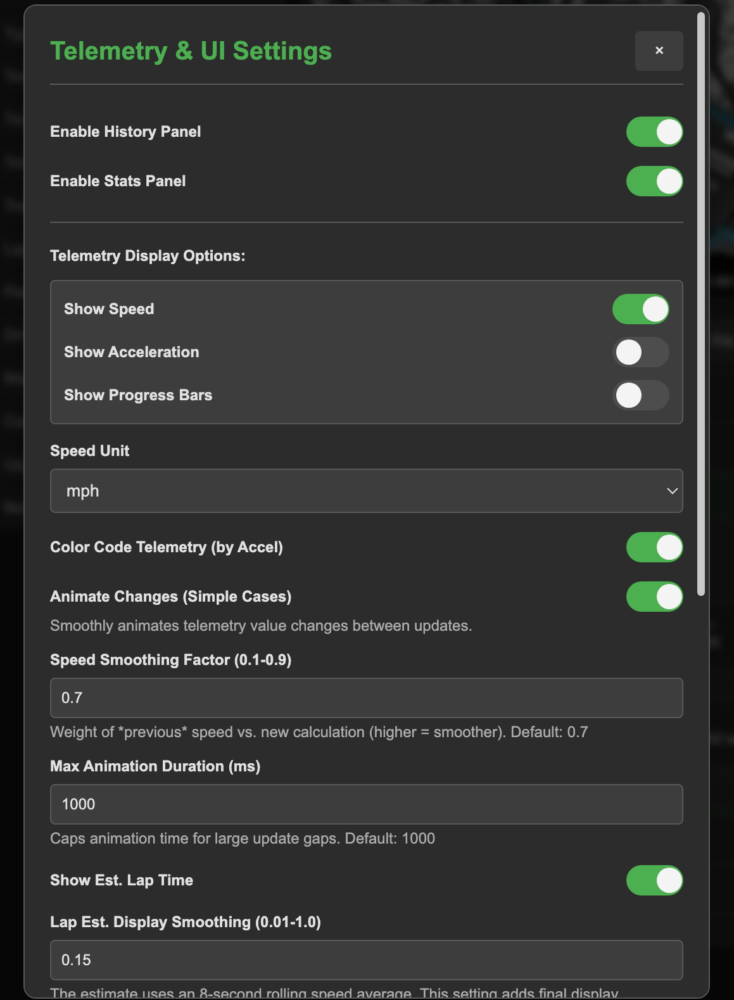

# Torn Racing Telemetry

Enhance Torn racing with a compact telemetry leaderboard, map-driver selection, API-powered analysis, and race-result exports.

## Table of Contents

- [Overview](#overview)
- [Key Features](#key-features)
- [Enhanced Driver List](#enhanced-driver-list)
- [History Panel](#history-panel)
- [Stats Panel](#stats-panel)
- [Export Panel](#export-panel)
- [Settings Panel](#settings-panel)
- [API Usage and Privacy](#api-usage-and-privacy)
- [Installation](#installation)
- [FAQ](#faq)

## Overview

Torn Racing Telemetry replaces Torn's default race list with a telemetry-first interface and adds API-powered analysis panels. It is designed for practical race-day use: quick reads, clear comparisons, map interaction, and detailed exports.

- Author: TheProgrammer ([2782979](https://www.torn.com/profiles.php?XID=2782979))
- Distribution: final bundled userscript (`tornracingtelemetry.js`)
- Compatibility: browser userscript managers and Torn PDA flow

## Key Features

### Enhanced UI and Telemetry

- Custom leaderboard that follows Torn's native race order. Click a driver row to select that driver on Torn's map; use `+` / `−` to open or close their details.
- Live Speed and Accel values with shared green/red acceleration coloring.
- Optional thin bars for full-race and current-lap progress; they automatically disappear for finished or crashed drivers.
- New installs show Speed, Accel, and progress bars by default.
- Color-coded telemetry by acceleration/deceleration.
- Expandable per-driver detail cards with position, lap metrics, race time, best lap, estimated lap time, skill gain, and optional API racing stats.

### Data and Analysis

- Stats panel with summary cards, comparison windows, and sortable track/car/race tables.
- History panel with summary cards, race-event timeline, and sortable recent-races table.
- Track and car static-data caching for faster panel loads.
- Comparison metrics tuned for limited-history windows (no hard 40-race requirement).

### Export and Configuration

- Export final race results as HTML, Markdown, CSV, TXT, or JSON.
- Copy exported race data to clipboard.
- Full settings panel for telemetry, animation, smoothing, API behavior, and UI toggles.
- Torn PDA API-key placeholder auto-setup support.
- Detailed JSON export with complete race, driver, timing, racing-skill, and Telemetry-specific data.

## Enhanced Driver List

The collapsed list keeps race order and the most useful live or completed-race information easy to scan.

In a completed race, each row shows the finish time or a clear crash status. During a live race, the same rows show the selected Speed, Accel, and progress-bar telemetry instead.

Expanding a driver shows status, race time/best lap when available, lap metrics, calculated Speed/Accel, estimated lap time, skill gain, and optional API racing stats. Cards without data stay hidden.

Telemetry color semantics:

- Green: positive acceleration.
- Red: braking/deceleration.
- Neutral: low/near-zero acceleration.

## History Panel

The History panel loads official races from the API on open and renders summary cards plus timeline/table views.

Highlights:

- Window comparison cards (`Last N vs Prev N`) for position trends.
- Average skill-per-race metric across loaded history.
- Race timeline for quick event review.
- Sortable recent-races table for detailed inspection.

## Stats Panel

The Stats panel focuses on performance analytics and breakdowns from official race history.

Highlights:

- Performance snapshot cards (wins, podiums, rates, best lap, etc.).
- Window-based deltas for position/win/crash/lap behavior.
- Track breakdown table and car breakdown table.
- Recent official races table with sortable columns.

## Export Panel

Export final race results in multiple formats or copy the output directly.

Available formats:

- HTML Table
- Markdown Table
- CSV
- Plain Text
- JSON

## Settings Panel

Configure all major behavior from one place.

The screenshot shows an example configuration; new installs enable Speed, Accel, and progress bars by default.

Main controls:

- Enable/disable History and Stats panels.
- Telemetry display options (Speed, Accel, progress bars).
- Speed unit, color coding, animation toggle, smoothing values.
- API key, API stats-on-click toggle, and race analysis limit.
- Hide/show Torn's original leaderboard.

## API Usage and Privacy

This script stores settings and the API key locally in userscript storage. API requests go only to Torn's official API, using the authorization header rather than including the key in request URLs.

| Item | Behavior |
|---|---|
| Data storage | Local only |
| Data sharing | None |
| API destination | `api.torn.com` only |
| Typical key level | Limited Access (custom selections) |
| Required selections | `user (personalstats, races)`, `racing (tracks, cars, records)` |

## Installation

1. Install a userscript manager (Tampermonkey or Violentmonkey).
2. Install the script from GreasyFork: <https://greasyfork.org/en/scripts/522245-torn-racing-telemetry>
3. Open Torn racing page and configure settings.
4. Add API key for full Stats/History/driver API features.
5. Torn PDA users can use the managed placeholder flow (`###PDA-APIKEY###`).
6. Use **Export** → **JSON Data (Detailed)** after a completed race for a file containing race-tracking data plus additional Telemetry details. An API key adds racing-skill data; without one, the file remains valid but leaves that field blank.

## FAQ

### Does this break Torn rules?

No. It is a UI enhancement script using Torn's public API endpoints.

### Is my API key safe?

The key is stored locally in userscript storage and used only for Torn API requests.

### Why do I need an API key?

Core on-page telemetry works without it, but Stats panel, History panel, and per-driver API stats require it.

### Why can Avg Pos Delta be red when it is positive?

Because lower finishing position is better. A positive delta means average finishing position number increased (worse performance).

### What if the script looks stale after update?

Hard refresh the page first. If needed, use Settings -> Clear Script Data.
