# Torn Racing Telemetry

Live racing telemetry, driver details, race history, statistics and result exports for Torn.

Version 4.0.0 is available on the `v4-testing` branch for testing. It has not been merged to `main` or published on GreasyFork.

## Racing interface

Torn's live track stays above the telemetry tabs. **Drivers**, **Car**, **Info**, **History**, **Stats**, **Export** and **Settings** share the area beneath it. Switching tabs preserves editable form state.

- **Drivers:** race order, speed, acceleration and optional race/lap progress bars. Select a row to follow that driver on the map; use its arrow to open the driver inspector.
- **Car:** current vehicle and performance information, when available. It disappears when the race finishes; if selected, the workspace returns to Drivers. Race actions use Torn's links and the script's confirmation dialog.
- **Info:** userscript information. The map header's separate ⓘ control opens race and track details.
- **History:** official race history, a timeline and sortable race results.
- **Stats:** performance summaries, recent-window comparisons, and track/car breakdowns.
- **Export:** completed race results in HTML, Markdown, CSV, text or detailed JSON, with clipboard support.
- **Settings:** display, smoothing, animation and API controls. Save validates all fields before writing changes. Invalid fields stay editable and receive focus.

Speed, acceleration and progress bars are enabled by default. Green indicates acceleration; red indicates braking. Waiting and finished drivers use their race status instead of fabricated live telemetry.

## Installation and upgrades

The published installation is available on [GreasyFork](https://greasyfork.org/en/scripts/522245-torn-racing-telemetry). Until 4.0.0 is published there, that page serves the previous release.

For this test build, open the [raw userscript](https://raw.githubusercontent.com/alxspiker/Torn-Racing-Telemetry/v4-testing/tornracingtelemetry.user.js) in your userscript manager. `tornracingtelemetry.js` is the canonical bundle; the build also writes an identical `.user.js` installer.

Version 4.0.0 restores the published name and namespace and keeps the existing configuration and API-key storage keys. It is intended to update the published installation. Disable or remove the separate **Torn Racing Telemetry (v4 Preview)** installation so both scripts do not run together. Preview settings are separate from the published installation's settings.

The update and download URLs point to GreasyFork. Updating this repository alone does not publish a GreasyFork update.

## API and local data

Core on-page telemetry works without an API key. History, Stats and driver API details require access to Torn's API. Enter a key in Settings, or use Torn PDA's managed `###PDA-APIKEY###` placeholder flow.

Settings, the API key and cached API results are stored locally in userscript storage. API requests go to `api.torn.com`; authentication uses a header instead of a key in the URL. Malformed JSON and invalid response shapes produce errors instead of empty results.

The script requests user race history and racing records, track/car data, track records, race details and driver personal statistics. Configure key access for the features you use. Detailed JSON exports can contain player and race data; review them before sharing.

**Clear Script Data** resets settings while retaining the API key. **Clear API Key** removes the stored key.

## Screenshots

Live screenshots supplied by TheProgrammer.

### Drivers and current car

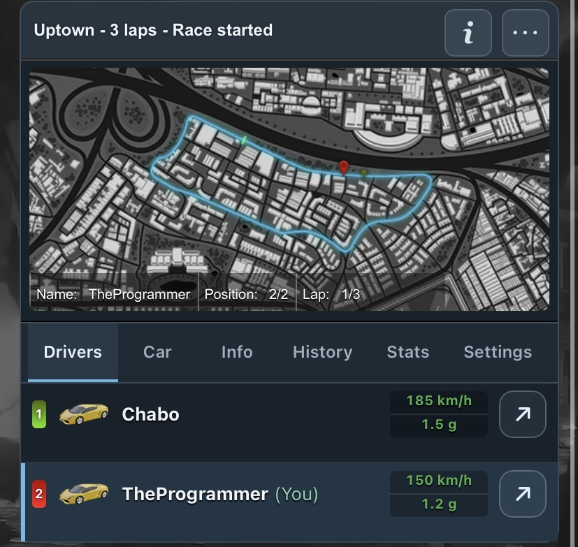

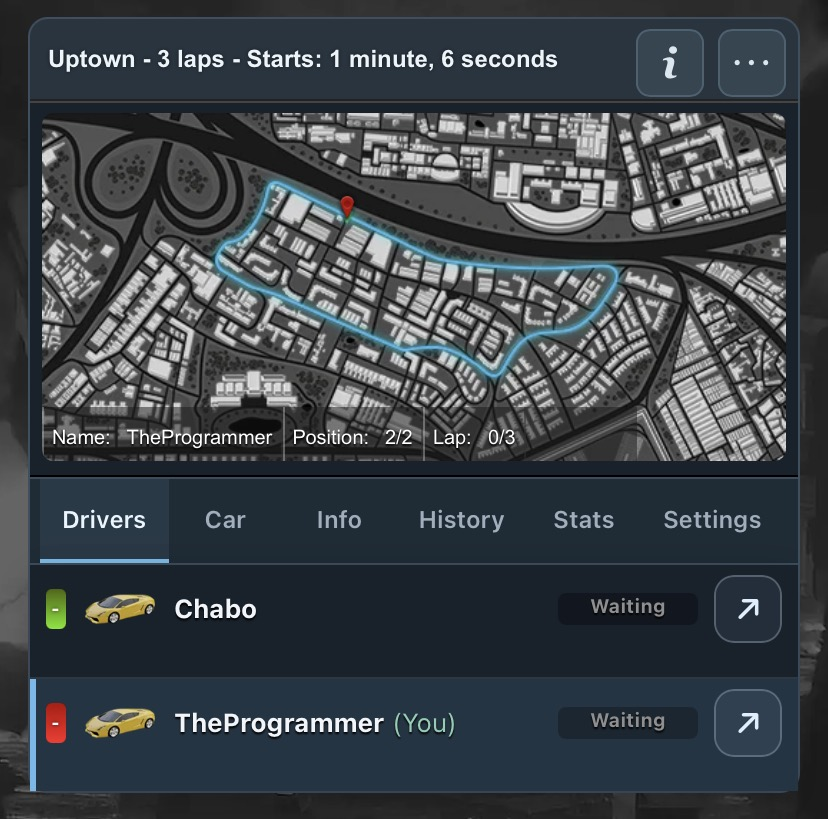

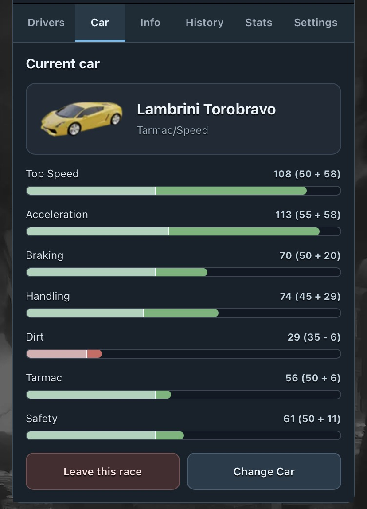

### Driver inspector

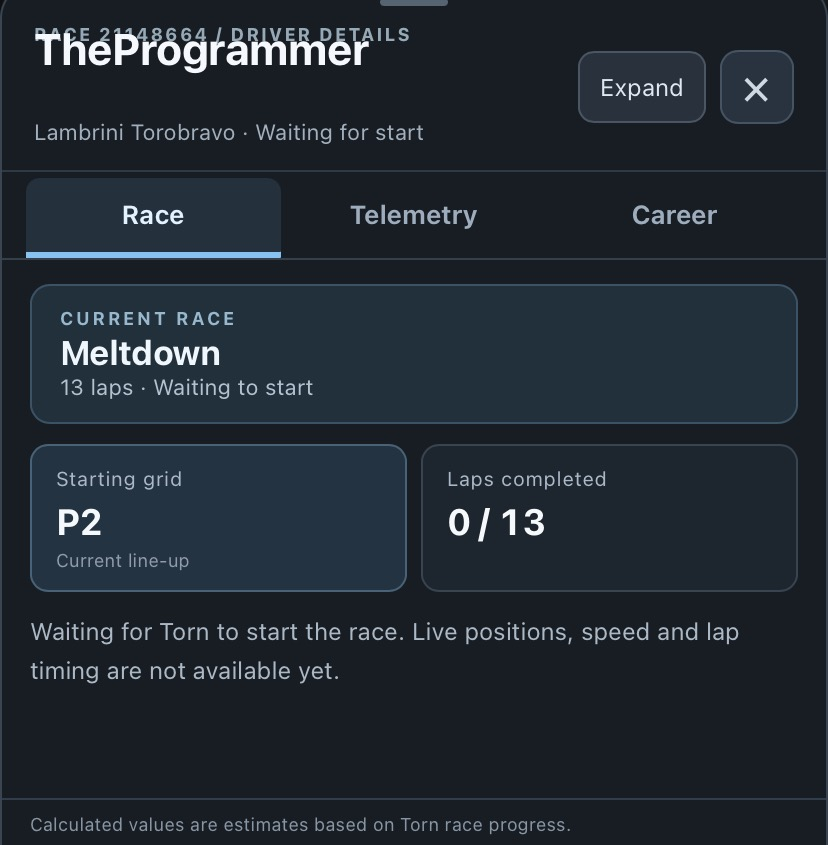

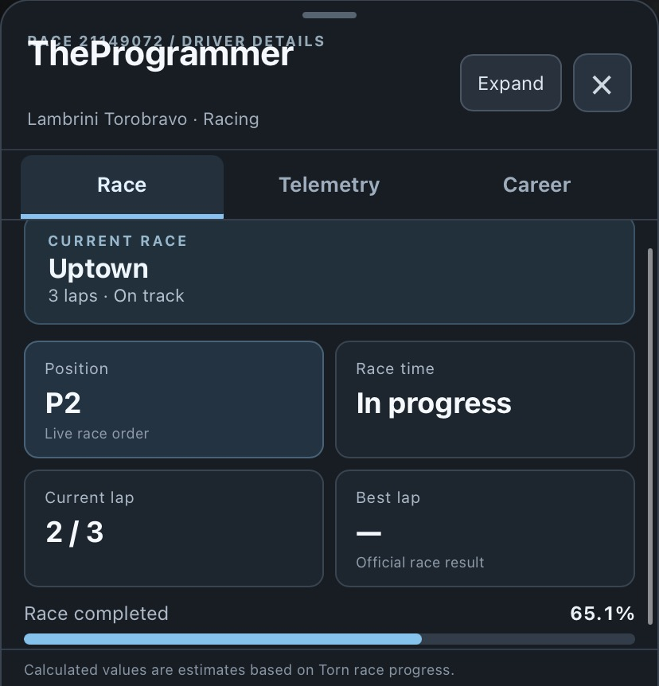

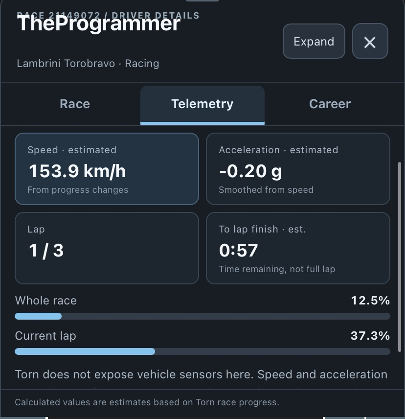

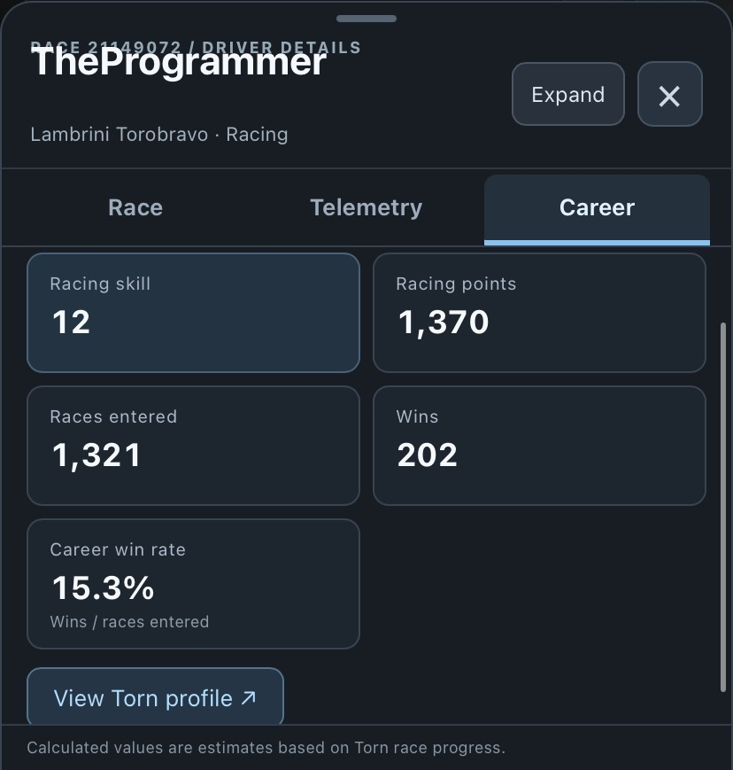

### History and statistics

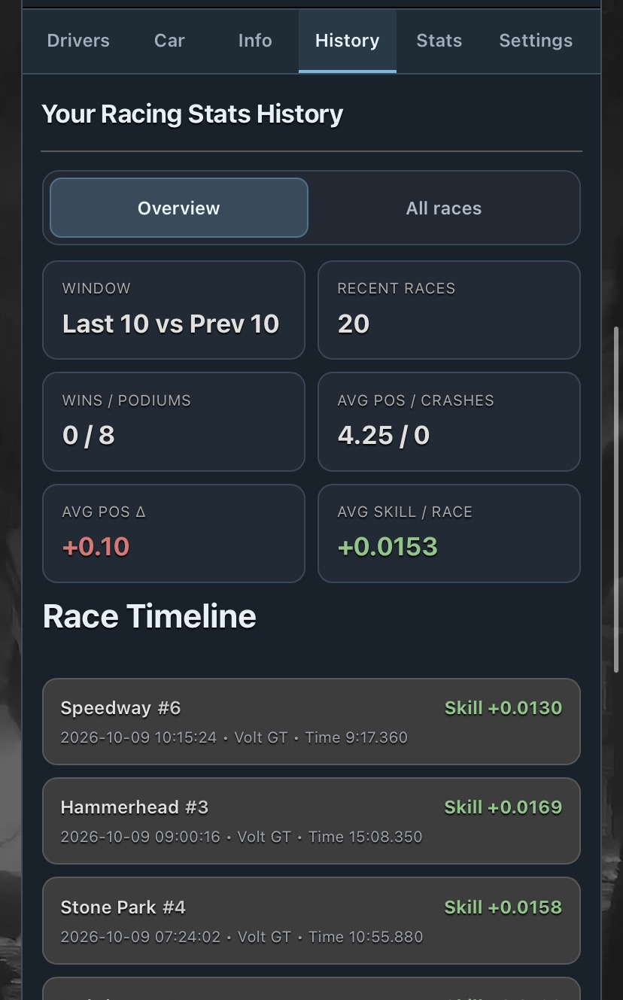

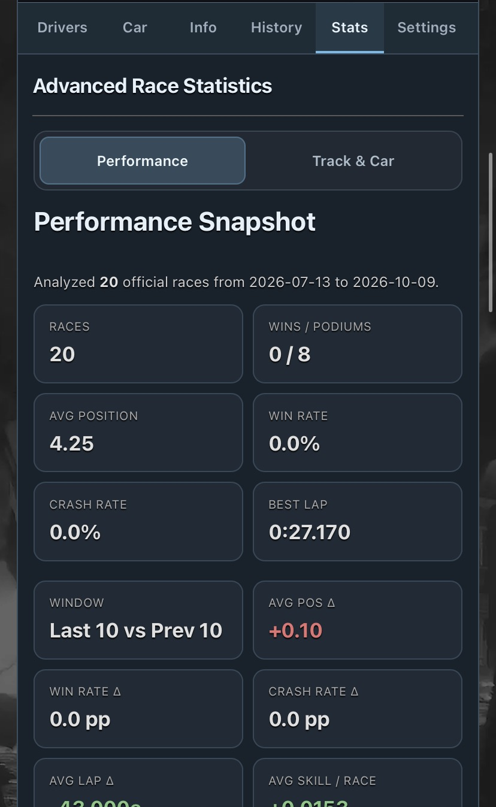

### Settings and race information

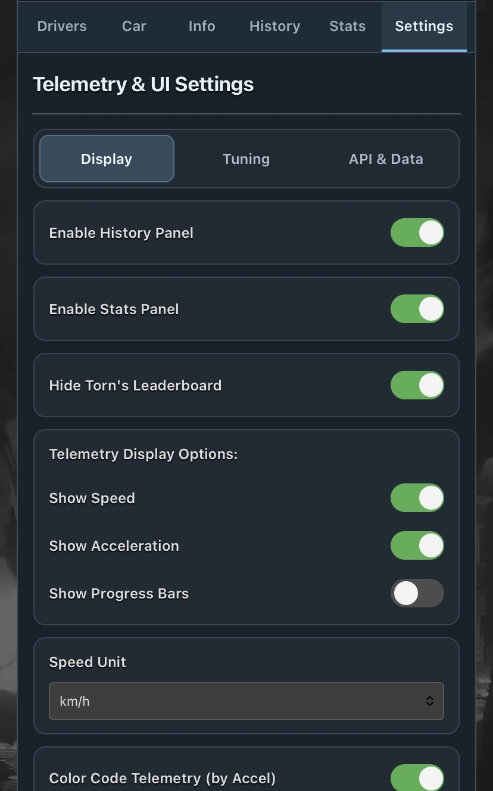

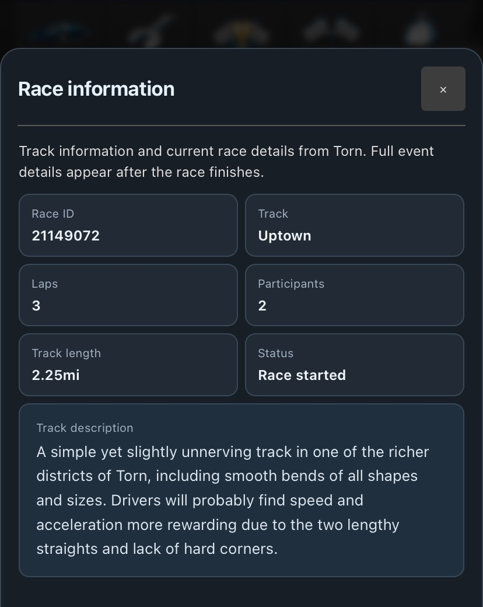

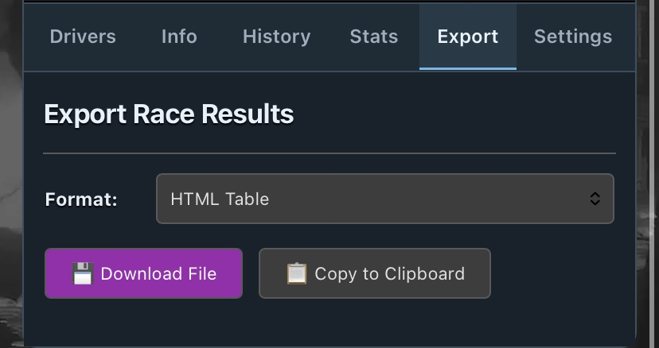

## Development and verification

Edit `src/userscript/`, then rebuild the single distributed bundle:

```sh
npm run build
npm run check
npm test
```

No build dependencies are required beyond Node.js and npm. The build joins the numbered source files in order.

The current 40 automated tests cover bundle syntax and release metadata, telemetry timing, race-data parsing, pagination, exports, inline integrations, settings validation and API response errors. `tests/mock-race.html` is a synthetic fixture. These tests do not establish live Torn or Torn PDA compatibility; live verification of the release fixes remains pending. The screenshots show user-observed live views; they do not verify the new validation or API error handling.

See [RELEASE_NOTES.md](RELEASE_NOTES.md) for 4.0.0 changes.

Author: [TheProgrammer (2782979)](https://www.torn.com/profiles.php?XID=2782979).
